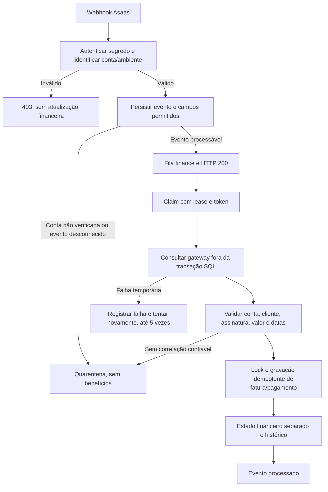

# Etapa 2 — Webhooks seguros e conciliação financeira

Entrega em 20/10/2026. Etapa 3 não iniciada.

## Resultado

Ingestão Asaas autenticada, persistência idempotente, fila financeira, processamento com lease e bloqueios de banco, consulta e conciliação por contexto explícito, cobertura financeira separada e histórico. A execução recorrente permanece desabilitada em produção e não há adapter Asaas V2 de produção nesta entrega.

Não foram executados cobranças, checkouts, criação de contas, atualizações na Railway, migrations produtivas, migrate:fresh ou rollback. Não houve conexão ao banco produtivo. As consultas de gateway dos testes foram simuladas, inclusive as consultas V1 de cobranças avulsas.

O repositório continua em `C:/xampp/htdocs/studioflow`, HEAD de referência `fd90262`. As alterações locais da Etapa 1 estavam sem commit e foram preservadas. A entrega foi construída e testada em uma cópia sem `.env`, com conferência de hashes antes da aplicação dos arquivos no repositório original.

## PostgreSQL confirmado e validação

O usuário confirmou PostgreSQL 18 na Railway, imagem `ghcr.io/railwayapp-templates/postgres-ssl:18`. A versão minor produtiva ainda não está confirmada. A indicação de atualização para 18.6 não foi tratada como prova de que a produção já executa 18.6.

Foi criada uma instância PostgreSQL **18.6**, portátil, exclusiva de teste, em Windows x64, com UTF-8 e locale C, ouvindo somente em `127.0.0.1:55438`. Foram usados os binários EDB indicados na [página oficial do PostgreSQL para Windows](https://www.postgresql.org/download/windows/). Não houve instalação de serviço global nem edição do php.ini; pdo_pgsql foi carregado apenas nos processos de teste.

Primeiro, o schema anterior foi aplicado em banco vazio isolado e recebeu contratos fictícios nos seis estados existentes. As duas migrations da Etapa 1 passaram sem incompatibilidade. Depois, um teste automatizado repetiu o upgrade completo em schema independente com seis contratos e seis pagamentos, verificando a preservação de todos os campos anteriores após as três migrations aditivas.

**Resultado: schema validado em PostgreSQL 18.6.** Nenhuma correção das migrations da Etapa 1 foi necessária. Elas permanecem intactas. Isso confirma compatibilidade no major 18 testado, sem afirmar igualdade de minor, sistema operacional, locale ou extensões com a produção.

## Fluxo de eventos



### Autenticação e compatibilidade

- Nova rota: `POST /webhooks/company-payments/asaas/{integration}/{environment}`, com environment sandbox ou production.
- A rota legada `POST /webhooks/company-payments/asaas` continua existindo. Ela exige que o segredo identifique exatamente uma integração Asaas. Não escolhe integração padrão nem usa fallback. Segredo compartilhado entre contas torna essa rota ambígua e é rejeitado; usar a rota explícita.
- Header `asaas-access-token` obrigatório e comparação com hash_equals. Conta e ambiente da rota são vinculados à integração; account.id e environment do payload, quando informados, devem corresponder ao contexto verificado.
- Conta autenticada mas sem identidade externa verificada recebe persistência em quarentena. Essa exceção não autoriza processamento nem a criação de outras referências financeiras sem verificação.
- Exige ID externo real do evento. Não fabrica ID a partir da cobrança. Eventos antigos sem ID válido devem ser corrigidos na origem; não ativam contratos.
- Idempotência usa o índice único conta/evento. Mesmo ID com conteúdo financeiro diferente retorna 409 e não sobrescreve o evento anterior.
- Persistência limitada a campos permitidos: identificadores, tipo, status, valor, método e vencimento. Não guarda cartão, nome do pagador ou payload arbitrário; erros usam uma lista de códigos permitidos, nunca mensagens remotas ou credenciais.
- A resposta é HTTP 200 após persistência e encaminhamento ao processamento assíncrono. Falha de encaminhamento não apaga o evento; scheduler recupera pendentes, falhos ou leases expirados.

O fluxo segue a [documentação de webhooks Asaas](https://docs.asaas.com/docs/about-webhooks): autenticação, ID idempotente, persistência e processamento assíncrono. Callbacks de checkout continuam fora desta etapa.

### Cobranças avulsas legadas

Uma cobrança V1 pode ser conciliada quando já tem vínculo explícito com conta verificada e origem `legacy_charge`. O worker consulta a cobrança pela credencial daquela conta, confere ID, cliente remoto da resposta original, ausência de assinatura recorrente, valor e confirmação. Registra o dinheiro sem ativar, suspender ou cancelar automaticamente o contrato.

Novas cobranças avulsas criadas pelo serviço existente passam a registrar a conta efetivamente usada quando ela já está verificada. Contratos e pagamentos anteriores não são vinculados por backfill. Cobranças sem vínculo confiável ficam em quarentena; não há seleção aproximada por empresa ou por integração ativa.

Os métodos legados de registro de pagamento continuam disponíveis, mas deixam de transformar pagamento em mudança automática de status contratual. Protegem pagamento já confirmado contra regressão e pagamento estornado contra reativação. Não armazenam payload bruto recebido como prova financeira.

## Jobs e recuperação

- ProcessFinancialEvent: claim transacional, limite de tentativas, lease de 180 segundos, token de posse, consulta remota e atualização com proteção contra worker antigo.
- ConsultGatewayCharge: consulta uma cobrança no contexto correto e aplica snapshot validado.
- ReconcileSubscription: consulta assinatura e percorre cobranças paginadas; possui bloqueio compartilhado para evitar sobreposição e registra execução, quantidade e falhas em subscription_reconciliations.
- IdentifyOverdueInvoices: identifica vencimentos locais mesmo sem webhook, preserva cobranças confirmadas e agenda consulta para regularização do estado.
- RecalculateFinancialState: recalcula cobertura e situação financeira separada da situação operacional.
- FinancialJob: fila finance, conexão database, afterCommit, até cinco tentativas, timeout de 60 segundos e backoff de 15/60/300/900 segundos.
- `financial:dispatch`, a cada cinco minutos: recupera eventos persistidos e leases expirados; só agenda recorrência Sandbox quando habilitada. Recuperação de eventos permanece disponível para as cobranças avulsas autenticadas mesmo com a recorrência desabilitada.

Não há requisição remota dentro das transações de aplicação. O resultado é aplicado sob lock da assinatura; evento com token antigo não pode gravar. Renovação ainda ausente localmente é criada a partir da referência externa da assinatura, com conferência de conta, cliente, valor e período.

Snapshots antigos não regridem cobranças pagas; estorno não volta a pago por evento atrasado. Uma nova execução de conciliação pode repetir consultas, mas os índices e locks impedem duplicar os registros financeiros correspondentes. Paginação com cursor repetido é interrompida e auditada.

## Cobertura e preservação dos contratos

Somente registros explicitamente marcados `billing_mode=recurring_v2` participam da projeção financeira V2. O estado active legado não é prova de pagamento.

O cálculo considera faturas confirmadas/recebidas, períodos contínuos sem atravessar intervalos não pagos, data inicial do contrato, vencimentos, tolerância congelada no snapshot comercial, pausas e términos. Calcula paid_through, grace_until, financial_status e motivo de suspensão. Estorno pode remover cobertura financeira; pagamento posterior ao cancelamento é registrado sem reativar o contrato.

**Status operacional, datas de ciclo, renovação e regras de elegibilidade do agendamento e PDV não são alterados por essa projeção.** O histórico registra transições com prefixo `financial.` para distinguir as duas dimensões. Pagamentos V2 não recebem os campos de ciclo usados pela regra legada; não liberam benefícios por acidente.

## Migrations

Nova migration: `database/migrations/2026_10_20_000003_add_financial_processing_infrastructure.php`.

- Acrescenta token de processamento, lease e índice de recuperação aos eventos.
- Acrescenta data de observação do gateway às faturas.
- Acrescenta motivo de suspensão e situação remota da recorrência aos contratos.
- Cria subscription_reconciliations com vínculos por empresa e conta e dados de auditoria da execução.

É aditiva, sem backfill ou alteração de estados existentes. O método down recusa rollback automático para preservar dados financeiros. Nenhuma migration foi aplicada ao banco local original ou produtivo nesta entrega.

## Testes e resultados

| Execução | Resultado |
|---|---|
| PostgreSQL 18.6: FinancialPipelineTest + PostgresFoundationUpgradeTest + FinancialAmountTest | **36 testes, 184 assertions, passaram** |
| PostgreSQL 18.6: FinancialConcurrencyTest, dois processos independentes | **1 teste, 11 assertions, passou** |
| SQLite em memória: pipeline, fundação e regressão financeira/operacional | **200 testes, 996 assertions, passaram** |
| Sintaxe PHP | **34 arquivos, sem erros** |
| Pint | Aplicado somente aos arquivos desta etapa |

A regressão abrange MembershipFoundationTest, MembershipFoundationUpgradeTest, MembershipPaymentGatewayTest, CompanyPaymentIntegrationTest, StudioFlowEnhancementTest, Phase2RetentionTest, PdvSaleTest, PublicBookingTest, PaymentTest, FinanceReportTest e CashRegisterTest, além do pipeline novo. Não se afirma execução de toda a suíte do repositório.

Cobertura dos requisitos: segredo correto/ausente/incorreto; empresa e ambiente errados; evento duplicado, alterado ou fora de ordem; renovação sem fatura local; pagamento após cancelamento; falha e retry; concorrência, lease expirado e worker antigo; conciliação sem webhook; histórico; legado sem adoção automática; ausência de benefício indevido. Também cobre quarentena de conta não verificada, paginação, estorno, início contratual futuro, tolerância, recuperação com recorrência desabilitada e centavos exatos sem dependência adicional de extensão PHP.

No teste de concorrência os dois workers foram liberados juntos por uma barreira. O resultado foi uma consulta simulada ao gateway, um pagamento, um histórico e uma tentativa efetiva; o status contratual permaneceu pending.

Falhas intermediárias corrigidas: o bootstrap inicial interferia nos handlers do PHPUnit e não reutilizava corretamente a conexão SQLite em memória; foi corrigido sem reset destrutivo. Um teste legado ainda esperava atualização sem autenticação/ativação imediata; foi ajustado ao novo limite de segurança e preservação contratual. As execuções finais acima não têm falhas ou testes arriscados.

### Reproduzir em ambiente isolado

O bootstrap `tests/financial-bootstrap.php` força ambiente testing, chave fictícia, cache/sessão em array, logs nulos e parâmetros de banco locais. Para PostgreSQL, exige a instância de teste em 127.0.0.1:55438 e usuário local studioflow_test, cria banco novo com prefixo studioflow_finance_test_, verifica major 18 e aplica apenas migrate incremental. Não lê URL produtiva, não usa migrate:fresh e não faz rollback de schema. Os dados fictícios dos bancos de teste podem ser inspecionados depois da execução.

```powershell
$env:FINANCE_TEST_DRIVER='pgsql'
php -d extension=pdo_pgsql vendor/phpunit/phpunit/phpunit --bootstrap tests/financial-bootstrap.php --do-not-cache-result tests/Feature/FinancialPipelineTest.php tests/Feature/PostgresFoundationUpgradeTest.php tests/Unit/FinancialAmountTest.php
php -d extension=pdo_pgsql vendor/phpunit/phpunit/phpunit --bootstrap tests/financial-bootstrap.php --do-not-cache-result tests/Feature/FinancialConcurrencyTest.php
```

Executar o teste de concorrência separadamente: ele cria fixtures confirmadas no banco de teste para permitir observação por dois processos. Os demais cenários usam transações de teste. Para a regressão SQLite, usar FINANCE_TEST_DRIVER=sqlite com o mesmo bootstrap e a seleção de suítes acima.

## Arquivos

Criados:

- app/Services/WebhookIngestionService.php
- app/Services/FinancialEventProcessor.php
- app/Services/SubscriptionReconciliationService.php
- app/Services/SubscriptionFinancialStateService.php
- app/Services/LegacyChargeReconciliationService.php
- app/Services/Payments/FinancialGatewayRegistry.php
- app/Services/Payments/FinancialErrorCode.php
- app/Services/Payments/FinancialAmount.php
- app/Jobs/FinancialJob.php
- app/Jobs/ProcessFinancialEvent.php
- app/Jobs/ConsultGatewayCharge.php
- app/Jobs/ReconcileSubscription.php
- app/Jobs/RecalculateFinancialState.php
- app/Jobs/IdentifyOverdueInvoices.php
- app/Console/Commands/DispatchFinancialWork.php
- config/financial.php
- database/migrations/2026_10_20_000003_add_financial_processing_infrastructure.php
- tests/financial-bootstrap.php
- tests/Feature/FinancialPipelineTest.php
- tests/Feature/FinancialConcurrencyTest.php
- tests/Feature/PostgresFoundationUpgradeTest.php
- tests/Support/FakeRecurringGateway.php
- tests/Support/financial-event-worker.php
- tests/Unit/FinancialAmountTest.php
- docs/financial-stage2.md

Modificados:

- app/Http/Controllers/CompanyPaymentWebhookController.php — somente fluxo Asaas e imports; método Mercado Pago preservado.
- app/Services/MembershipBillingService.php — ingestão autenticada, vínculo de novas cobranças avulsas verificadas e proteção do contrato legado.
- app/Models/CustomerMembership.php — atributos novos da projeção.
- app/Models/MembershipInvoice.php — observação do gateway.
- app/Models/PaymentWebhookEvent.php — campos de processamento.
- app/Models/Concerns/ValidatesFinancialCompany.php — admite conta ainda não verificada somente para evento em quarentena; mantém validação de empresa.
- app/Providers/AppServiceProvider.php — registro do registry como singleton.
- routes/web.php — rota explícita de webhook Asaas.
- bootstrap/app.php — agendamento da recuperação financeira.
- tests/Feature/MembershipPaymentGatewayTest.php — expectativas de autenticação, ingestão assíncrona e preservação do contrato.

Preservados: interface V1, interface V2 da Etapa 1, AsaasGateway, MercadoPagoGateway, GalaxyPayGateway, BookingPaymentService, métodos de pagamento Mercado Pago, PDV, caixa, relatórios e queries de elegibilidade existentes.

## Pendências, limites e funcionalidades desabilitadas

1. Confirmar a versão minor exata produtiva antes da implantação. A validação atual é em 18.6 Windows; a imagem Railway informada usa major 18 em Linux.
2. Nenhuma migration foi aplicada em produção. A implantação deve aplicar a estrutura antes de encaminhar requisições aos novos handlers e iniciar o worker finance/scheduler. Essa operação não foi executada.
3. FINANCIAL_RECONCILIATION_ENABLED é false por padrão. Há bloqueio adicional em ambiente production e em contas não Sandbox, mesmo que a flag seja habilitada. Não existe adapter Asaas V2 real nesta entrega; somente fakes em testing podem ser registrados pelo mecanismo de teste.
4. Contas externas precisam de verificação e segredos corretamente configurados. Eventos antigos sem ID e vínculos históricos sem conta/ambiente confiáveis exigem revisão; não se faz backfill automático. Quarentena não é reprocessada silenciosamente após mudança cadastral.
5. Cobranças avulsas com vínculo explícito e prova remota mantêm o registro monetário. Contratos não são ativados automaticamente por esse fluxo. A gestão/revisão de ativação contratual continua pendente para as etapas correspondentes.
6. Worker e scheduler precisam estar operando para consumo da fila e recuperação. Tentativas esgotadas exigem atenção operacional; não há painel administrativo de replay nesta etapa.
7. Ainda não há checkout público, criação recorrente real, alteração de renovação no gateway, nova política de benefícios, painel de assinantes ou integração desse ledger nos relatórios/caixa. Eventos de checkout e tipos não suportados permanecem em quarentena.
8. Falhas/chargebacks com estados ainda não normalizados pelo futuro adapter são quarentenados. A cobertura depende de períodos e datas autoritativos fornecidos por esse adapter; não se infere mensalidade como 30 dias.
9. A verificação usou dados fictícios, sem inspecionar ou transformar dados produtivos. Questões legadas já apontadas na auditoria — referências de cliente V1 sem namespace de conta e relações antigas com cascade — não foram migradas silenciosamente.

Nenhuma parte da Etapa 3 foi iniciada.
